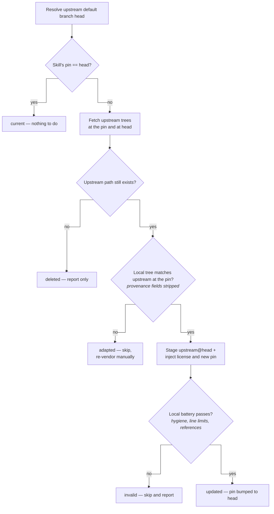

# Agent Skills

A version-controlled catalog of agent skills covering software engineering and project management. Installable into any `SKILL.md`-compatible harness (Claude Code, Codex CLI, OpenCode, Oh My Pi, Cursor, and others) without per-harness forks of the content.

Conforms to the [Agent Skills](https://agentskills.io) and [Agent Plugins 1.0.0](https://agent-plugins.org) standards.

## Quick Start

**One-liner** (clones and links all skills to OpenCode):

```bash
curl -fsSL https://raw.githubusercontent.com/JakobHavtorn/agent-skills/main/install.sh | bash
```

Customize with flags:

```bash
curl ... | bash -s -- --agent claude        # link to Claude Code
curl ... | bash -s -- --all                # link everything to all harnesses
curl ... | bash -s -- --plugin coding       # link only the coding plugin
```

**Manual** (if you prefer to clone yourself):

```bash
git clone git@github.com:JakobHavtorn/agent-skills.git ~/.agent-skills
~/.agent-skills/bin/setup --agent opencode
```

Clone once, link many — `git pull && bin/setup` updates every harness at once.

Verify your installation:

```bash
~/.agent-skills/bin/skillctl doctor   # check links, orphans, broken symlinks
```

### Developer setup

For local development (installs pre-commit hooks for ruff, formatting, and file checks):

```bash
make install    # installs pre-commit, ruff, and wires git hooks
make test       # runs skillctl unit tests
make pre-commit # runs all hooks on all files
```

### Supported harnesses

| Harness | User scope | Project scope |
|---|---|---|
| Claude Code | `~/.claude/skills/<name>/` | `.claude/skills/` |
| Codex CLI | `~/.codex/skills/<name>/` | `.agents/skills/` |
| OpenCode | `~/.config/opencode/skills/<name>/` | `.opencode/skills/` |
| Cursor | `~/.cursor/skills/<name>/` | `.cursor/skills/` |
| Oh My Pi | `~/.omp/agent/skills/<name>/` | `.omp/skills/` |
| Pi | `~/.pi/agent/skills/<name>/` | `.pi/skills/` |

### Commands

```bash
skillctl list                          # list all plugins and skills
skillctl link --plugin <p> --agent <a> # symlink a plugin's skills into a harness
skillctl link --agent <a>              # symlink every plugin into a harness
skillctl unlink --plugin <p> --agent <a>  # remove a plugin's links
skillctl prune --agent <a>             # dry-run: report stale links and orphans
skillctl prune --agent <a> --apply     # remove links whose source skill was deleted
skillctl sync                          # update tracked vendored skills from upstream
skillctl sync --dry-run                # report drift and planned updates, no writes
skillctl test                          # run trigger detection tests for all skills
skillctl test --skill <name> --verbose # test a single skill with per-case output
skillctl doctor                        # report links, orphans, broken symlinks
skillctl help                          # show detailed help with examples
```


## Context file

`skillctl link` also symlinks `global/AGENTS.md` into each harness's top-level config directory as `AGENTS.md`. This file contains high-level agent working rules (worktree policy, verification) that apply across all projects. It is linked at user scope only and lives alongside per-harness files like `~/.claude/CLAUDE.md` without replacing them.

| Harness | Context file path |
|---|---|
| Claude Code | `~/.claude/AGENTS.md` |
| Codex CLI | `~/.codex/AGENTS.md` |
| OpenCode | `~/.config/opencode/AGENTS.md` |
| Cursor | `~/.cursor/AGENTS.md` |
| Oh My Pi | `~/.omp/agent/AGENTS.md` |
| Pi | `~/.pi/agent/AGENTS.md` |

## Agents

The `agents/` directory holds standalone agent definitions that are not tied to a specific skill. `skillctl link` symlinks the entire `agents/` directory into each harness's config tree (user scope only), alongside the context file.

| Harness | Agents path |
|---|---|
| Claude Code | `~/.claude/agents/` |
| Codex CLI | `~/.codex/agents/` |
| OpenCode | `~/.config/opencode/agents/` |
| Cursor | `~/.cursor/agents/` |
| Oh My Pi | `~/.omp/agent/agents/` |
| Pi | `~/.pi/agent/agents/` |

| Agent | Description |
|---|---|
| [title.md](agents/title.md) | Hidden title generator — produces short session titles from conversation content |

## Plugins
### `coding`
Software engineering skills — Linear tickets, pull requests, code review.

| Skill | Description |
|---|---|
| [api-designer](plugins/coding/skills/api-designer) | Design REST/GraphQL APIs with OpenAPI 3.1 specs — resource modeling, versioning, pagination, RFC 7807 errors (vendored from Jeffallan/claude-skills) |
| [find-skills](plugins/coding/skills/find-skills) | Discover and install skills from the open agent skills ecosystem |
| [frontend-design](plugins/coding/skills/frontend-design) | Distinctive, intentional visual design for new or reshaped UI |
| [incident-trace](plugins/coding/skills/incident-trace) | Trace incidents through backend services from Loki logs — receipts, negative evidence, verdicts |
| [linear-ticket](plugins/coding/skills/linear-ticket) | Create a Linear issue with proper template, fields, and metadata |
| [mermaid](plugins/coding/skills/mermaid) | Generate Mermaid diagrams — 32 types via lookup table linking to official docs |
| [open-pr](plugins/coding/skills/open-pr) | Create or update a PR — lints, tests, commits, pushes, Linear-linked description |
| [resolve-merge-conflicts](plugins/coding/skills/resolve-merge-conflicts) | Resolve merge/rebase conflicts hunk by hunk, traced to each side's intent |
| [review-pr-comments](plugins/coding/skills/review-pr-comments) | Address PR review comments fetched via `gh api` |
| [skill-creator](plugins/coding/skills/skill-creator) | Create, evaluate, and iterate on agent skills |
| [synapse](plugins/coding/skills/synapse) | Query the Grafana stack via the Synapse MCP server — Mimir metrics, Loki logs, Pyroscope profiles, dashboards, alerting |
| [technical-writing](plugins/coding/skills/technical-writing) | Draft and edit prose with Orwell's rules and ASD-STE100 Simplified Technical English |

### `pm`

Project management and team productivity skills.

| Skill | Description |
|---|---|
| [prioritize-tasks](plugins/pm/skills/prioritize-tasks) | Prioritized task list from Linear, Slack, and To-do doc |
| [standup-summary](plugins/pm/skills/standup-summary) | Standup recap from Linear activity and Slack messages |
| [speechrec-weekly-update](plugins/pm/skills/speechrec-weekly-update) | Pre-read status update for the weekly Speech Recognition sync call |
| [speechrec-sprint-goals](plugins/pm/skills/speechrec-sprint-goals) | Draft SR team sprint goals from Notion, Linear, and Slack |

### `pocock`

Engineering and planning workflow skills — vendored from [mattpocock/skills](https://github.com/mattpocock/skills) at commit `5863806d` (MIT). Pin-controlled: updates land only by deliberate re-vendoring, not automatically.

| Skill | Description |
|---|---|
| [code-review](plugins/pocock/skills/code-review) | Two-axis diff review — standards and spec, in parallel sub-agents (vendored from mattpocock/skills) |
| [codebase-design](plugins/pocock/skills/codebase-design) | Shared vocabulary for deep-module design (vendored from mattpocock/skills) |
| [diagnosing-bugs](plugins/pocock/skills/diagnosing-bugs) | Disciplined diagnosis loop for hard bugs and regressions — red-capable repro, minimise, hypothesise, instrument, fix (vendored from mattpocock/skills) |
| [domain-modeling](plugins/pocock/skills/domain-modeling) | Build and sharpen a project's domain model — GLOSSARY.md and ADRs inline (vendored from mattpocock/skills) |
| [grill-me](plugins/pocock/skills/grill-me) | Relentless interview to sharpen a plan or design (user-invoked, vendored from mattpocock/skills) |
| [grill-with-docs](plugins/pocock/skills/grill-with-docs) | Grilling session that also builds the project's domain docs — glossary and ADRs (user-invoked, vendored from mattpocock/skills) |
| [grilling](plugins/pocock/skills/grilling) | Stress-test a plan or decision via a design-tree interview in rounds (vendored from mattpocock/skills) |
| [handoff](plugins/pocock/skills/handoff) | Compact the session into a handoff document for the next agent (vendored from mattpocock/skills) |
| [implement](plugins/pocock/skills/implement) | Build the work described by a spec or tickets, driving tdd at pre-agreed seams and closing with code-review (user-invoked, vendored from mattpocock/skills) |
| [improve-codebase-architecture](plugins/pocock/skills/improve-codebase-architecture) | Survey a codebase for deepening opportunities, present an HTML report, then grill the pick (user-invoked, vendored from mattpocock/skills) |
| [pr](plugins/pocock/skills/pr) | The shape a PR body — summary as the smallest visual, before/after evidence, merge-danger call (vendored from mattpocock/skills) |
| [prototype](plugins/pocock/skills/prototype) | Throwaway prototype to answer a design question — shareable logic demo or switchable UI variants (vendored from mattpocock/skills) |
| [research](plugins/pocock/skills/research) | Investigate a question against primary sources via a background agent, captured as a cited markdown doc (vendored from mattpocock/skills) |
| [tdd](plugins/pocock/skills/tdd) | Test-driven development — red-green-refactor with tests worth keeping (vendored from mattpocock/skills) |
| [to-spec](plugins/pocock/skills/to-spec) | Turn the current conversation into a spec as a markdown document (vendored from mattpocock/skills) |
| [to-tickets](plugins/pocock/skills/to-tickets) | Decompose a plan into tracer-bullet tickets with blocking edges, published to Linear (vendored from mattpocock/skills) |

### `grafana`

Observability skills for the Grafana stack — vendored from [grafana/skills](https://github.com/grafana/skills) at commit `8fb72a52` (Apache-2.0). The `synapse` skill covers live querying via MCP; these carry the per-product knowledge.

| Skill | Description |
|---|---|
| [alerting-irm](plugins/grafana/skills/alerting-irm) | Grafana alerting, incident response management, and SLOs — multi-window burn-rate alerts, on-call schedules, integrations (vendored from grafana/skills) |
| [alloy](plugins/grafana/skills/alloy) | Grafana Alloy telemetry pipelines — one OpenTelemetry-compatible binary collecting metrics, logs, traces, and profiles (vendored from grafana/skills) |
| [app-observability](plugins/grafana/skills/app-observability) | Grafana Cloud Application Observability — RED metrics, service maps, frontend RUM, AI/LLM monitoring (vendored from grafana/skills) |
| [beyla](plugins/grafana/skills/beyla) | Auto-instrument HTTP/gRPC/DB traffic with Grafana Beyla eBPF — no code changes, no SDK (vendored from grafana/skills) |
| [dashboarding](plugins/grafana/skills/dashboarding) | Build and ship Grafana dashboards as JSON — panels, variables, transformations, links (vendored from grafana/skills) |
| [grafana-oss](plugins/grafana/skills/grafana-oss) | Configure self-hosted Grafana OSS — provisioning, data sources, plugins, health checks (vendored from grafana/skills) |
| [loki](plugins/grafana/skills/loki) | Grafana Loki log aggregation — LogQL queries, pipelines, and architecture (vendored from grafana/skills) |
| [loki-label-analyzer](plugins/grafana/skills/loki-label-analyzer) | Evaluate and improve a Loki label strategy — cardinality, query patterns, label hygiene (vendored from grafana/skills) |
| [mimir](plugins/grafana/skills/mimir) | Stand up Grafana Mimir — horizontally scalable, multi-tenant, long-term Prometheus and OTLP metrics storage (vendored from grafana/skills) |
| [opentelemetry](plugins/grafana/skills/opentelemetry) | Instrument any app with OpenTelemetry — metrics, logs, traces to Grafana Cloud or a self-hosted stack (vendored from grafana/skills) |
| [performance-rca](plugins/grafana/skills/performance-rca) | Root-cause CPU, memory, and contention problems with Pyroscope profiles via gcx (vendored from grafana/skills) |
| [profilecli-insights](plugins/grafana/skills/profilecli-insights) | Query live Pyroscope profiles with profilecli, analyze with pprof, correlate with source code (vendored from grafana/skills) |
| [prometheus](plugins/grafana/skills/prometheus) | Prometheus and Grafana Cloud Metrics — PromQL, alerting, recording rules, integration patterns (vendored from grafana/skills) |
| [prometheus-cardinality-troubleshooter](plugins/grafana/skills/prometheus-cardinality-troubleshooter) | Diagnose active Prometheus cardinality problems — slow queries, OOMs, series churn, high bills (vendored from grafana/skills) |
| [prometheus-label-strategy](plugins/grafana/skills/prometheus-label-strategy) | Evaluate and improve a Prometheus label strategy on Grafana Cloud (vendored from grafana/skills) |
| [promql](plugins/grafana/skills/promql) | Write, validate, and optimize PromQL for Prometheus / Mimir / Grafana Cloud Metrics (vendored from grafana/skills) |
| [pyroscope](plugins/grafana/skills/pyroscope) | Continuous profiling with Grafana Pyroscope — flame graphs and diff views (vendored from grafana/skills) |
| [tempo](plugins/grafana/skills/tempo) | Grafana Tempo distributed tracing — TraceQL, service graphs, correlations (vendored from grafana/skills) |

## Vendored skills

Some skills are vendored from upstream repositories. Provenance lives in each skill's SKILL.md frontmatter, so it travels with the drop-in copy:

```yaml
license: MIT
metadata:
  vendored-from: https://github.com/mattpocock/skills/tree/<pinned-commit>/skills/engineering/tdd
```

The `vendored-from` URL pins the exact upstream commit. It records origin, not byte identity — local adaptations are intentional.

Vendored plugins declare their upstream in `plugin.json` with a policy per source:

```json
{
  "name": "grafana",
  "sources": [
    {
      "repo": "grafana/skills",
      "policy": "track",
      "include": ["skills/grafana-core/promql", "skills/grafana-lgtm/tempo"],
      "license": "Apache-2.0"
    }
  ]
}
```

- **`track`** — `skillctl sync` pulls these skills toward the upstream default branch head and opens a sync PR. The `grafana` plugin uses this.
- **`pin`** — updates land only by deliberate manual re-vendoring. `skillctl sync` never touches them, but its skip lines show each skill's drift state (current / drifted / upstream moved elsewhere); `vendor-status` reports the same drift with a manual hint. The `pocock` plugin uses this.

`include` lists the upstream skill directories the source manages. An explicit list is a curation decision: new upstream skills appear only when you add their path. Glob patterns (`skills/grafana-core/*`) opt in to everything they match.

Per skill, sync compares the local tree against upstream at the skill's pin — provenance fields aside — and acts on what it finds:

- **clean** (byte-identical to the pin) → updated to the new head, pin bumped, validated, included in the sync PR
- **adapted** (hand-edited locally) → skipped and reported; re-vendor manually
- **deleted upstream** → skipped and reported

The decision flow for one track source:



```bash
python3 bin/skillctl sync --dry-run    # report drift and planned updates
python3 bin/skillctl sync              # apply clean updates to the working tree
python3 bin/skillctl sync --pr         # apply, then commit, push, and open a PR
```

Check every vendored skill for upstream drift:

```bash
python3 bin/vendor-status              # human-readable table with per-source hints
python3 bin/vendor-status --strict     # also fail on unparsable provenance
```

The weekly workflow (`.github/workflows/vendor-drift.yml`) runs both: `vendor-status` files or updates the drift issue, and `skillctl sync --pr` opens a `sync/upstream` PR whenever tracked sources have clean updates. Sync PRs opened by the workflow use `GITHUB_TOKEN` and therefore do not re-trigger `validate.yml` — `skillctl sync` runs the same deterministic battery (data hygiene, line limits, reference integrity) locally before opening the PR. Syncing from your own checkout runs the full CI on the PR as usual.

To update a **pin-controlled** vendored skill by hand: copy the upstream files at the newer commit, re-apply the local adaptations, update the `vendored-from` pin, and open a PR.

## License

MIT — see [LICENSE](LICENSE).
