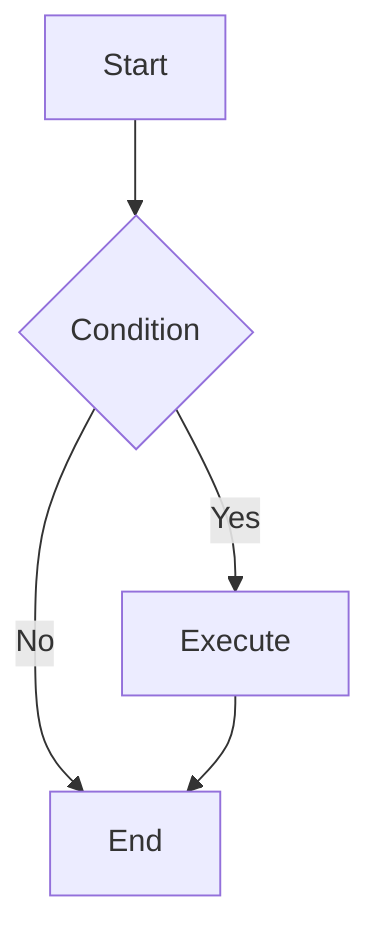

# Mermaid Diagram Generator

Generate high-quality Mermaid diagram code from user requirements. The skill references the official Mermaid documentation for accurate, current syntax rather than vendoring stale copies.

## Step 1: Identify the Diagram Type

Read `references/diagram-types.md` — the canonical lookup of every Mermaid diagram type, its keyword, use cases, and a link to the official syntax documentation. The "Use Cases" column routes user intent to the right type; the table covers all 32 types plus configuration topics.

Pick the most suitable type based on the user's description. When the user names a type that does not appear in the table, it is not a supported Mermaid diagram type.

## Step 2: Read the Official Syntax Documentation

Once the diagram type is chosen, read the linked official documentation page for exact, current syntax. Every entry in `references/diagram-types.md` links to `https://mermaid.ai/open-source/syntax/<chart_type>.html` (or `/config/<topic>.html` for styling).

This ensures generated code matches the latest Mermaid syntax — the lookup table stays current because it links to live docs rather than vendoring markdown that drifts.

## Step 3: Generate Diagram Code

Generate Mermaid code following the official specification read in Step 2:

1. Be wrapped in ` ```mermaid ` code blocks
2. Have correct syntax that renders directly
3. Have clear structure with proper line breaks and indentation
4. Use semantic node naming
5. Include styling when needed to improve visual appearance

## Step 4: Apply Styling (optional)

If the user requests themes, colors, or layout configuration, read the relevant configuration page:

- [Theming](https://mermaid.ai/open-source/config/theming.html) — custom colors, themes, looks
- [Directives](https://mermaid.ai/open-source/config/directives.html) — diagram-level configuration
- [Layouts](https://mermaid.ai/open-source/config/layouts.html) — layout direction and spacing
- [Math](https://mermaid.ai/open-source/config/math.html) — LaTeX math support

## Example Output



## Reference Files

- `references/diagram-types.md` — Canonical lookup: every diagram type, its keyword, use cases, and a link to the official syntax documentation

---

User requirements: $ARGUMENTS
